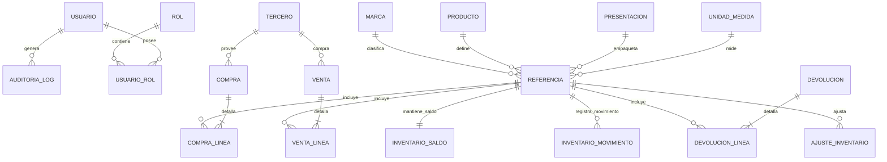

# Documento: Modelo Entidad-Relación y Estructura de Datos

## Metadatos
* **Nombre:** 02_modelo_entidad_relacion.md
* **Descripción:** Especificación técnica del modelo entidad-relación, entidades conceptuales, relaciones, cardinalidades, restricciones de integridad y reglas de persistencia para el sistema de inventario.
* **Fecha de creación:** 13 de octubre de 2026
* **Fecha de última actualización:** 13 de octubre de 2026
* **Autor:** Agente de IA (Arquitecto de Software y Modelador de Datos)
* **Versión:** 1.0
* **Estado:** Borrador (En revisión)

---

## 1. Descripción General del Modelo
El modelo de datos ha sido diseñado para soportar las operaciones de una ferretería de sede única garantizando:
1. **Separación entre Saldo y Movimientos:** Una entidad de saldo rápido (`inventario_saldo`) para validaciones de concurrencia y un registro inmutable de transacciones (`inventario_movimiento`) para el Kárdex.
2. **Conservación de Costos Históricos:** En la entidad `venta_linea` se preserva el atributo `costo_historico_unitario` correspondiente al CPP en el momento exacto de la venta.
3. **Catálogo Normalizado:** La referencia comercializable (`referencia`) se compone de la relación entre `producto`, `marca`, `presentacion` y `unidad_medida`, contando con un código de barras único en todo el catálogo.
4. **Terceros Unificados:** Una única tabla `tercero` para clientes y proveedores identificados por su documento fiscal único (NIT o Cédula).

---

## 2. Diagrama Entidad-Relación (Mermaid)

El diagrama fuente en sintaxis Mermaid se encuentra respaldado en el archivo `02_modelo_entidad_relacion.mmd`.

---

## 3. Entidades Principales y Cardinalidad

### 3.1 Identidad y Seguridad
* **`usuario` (1) ── (N) `usuario_rol` (N) ── (1) `rol`:** Relación muchos a muchos para representar la asignación de roles (`ROLE_ADMINISTRADOR`, `ROLE_USUARIO_OPERATIVO`).

### 3.2 Catálogo
* **`producto` (1) ── (N) `referencia`:** Un producto genérico (ej. "Tornillo de Ensamble") puede tener múltiples referencias comerciales.
* **`marca` (1) ── (N) `referencia`:** Una marca clasifica varias referencias vendibles.
* **`presentacion` (1) ── (N) `referencia`:** Forma de empaque comercial (ej. "Caja x 100", "Bolsa x 1kg", "Galón", "Unidad").
* **`unidad_medida` (1) ── (N) `referencia`:** Unidad base física de inventario (ej. "UND", "MTR", "KGM", "GLN").
* **Restricción de Unicidad:** `codigo_barras` es único a nivel de catálogo. La tupla `(producto_id, marca_id, presentacion_id)` debe ser única.

### 3.3 Inventario y Kárdex
* **`referencia` (1) ── (1) `inventario_saldo`:** Cada referencia tiene exactamente un registro de saldo con su cantidad disponible y su costo promedio ponderado vigente.
* **`referencia` (1) ── (N) `inventario_movimiento`:** Historial cronológico inmutable de entradas y salidas.

### 3.4 Compras
* **`tercero` (1) ── (N) `compra`:** Cada compra se asigna obligatoriamente a un tercero con `es_proveedor = true`.
* **`compra` (1) ── (N) `compra_linea`:** Cada compra tiene 1 o más líneas.

### 3.5 Ventas y Devoluciones
* **`tercero` (1) ── (N) `venta`:** Cada venta se asigna obligatoriamente a un tercero con `es_cliente = true` (RN-05).
* **`venta` (1) ── (N) `venta_linea`:** Cada venta tiene 1 o más líneas.
* **`venta` (0..1) ── (N) `devolucion`:** Una venta puede originar cero o múltiples devoluciones parciales (o devoluciones no vinculadas sin venta).

---

## 4. Reglas de Integridad y Eliminación de Datos

1. **Protección contra Borrado Físico (RN-02):**
   * Las tablas `referencia`, `producto`, `marca`, `presentacion` y `tercero` cuentan con la columna booleana `activo`.
   * Si una referencia posee transacciones en `inventario_movimiento`, `venta_linea` o `compra_linea`, la base de datos restringe el borrado físico (`ON DELETE RESTRICT`). Para retirar la referencia del catálogo se actualiza `activo = false`.
2. **Inmutabilidad del Kárdex:**
   * La tabla `inventario_movimiento` es estrictamente de inserción (`INSERT-only`). No se permiten sentencias `UPDATE` ni `DELETE` sobre registros históricos.
3. **Control de Consecutivos:**
   * La tabla `comprobante_consecutivo` almacena el último número generado para cada tipo de documento (`VENTA`, `COMPRA`, `DEVOLUCION`, `AJUSTE`) asegurando numeración correlativa mediante incremento atómico.
